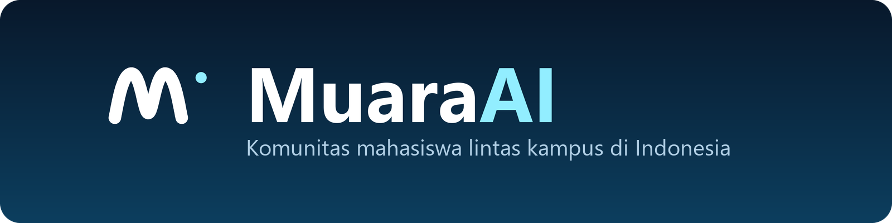
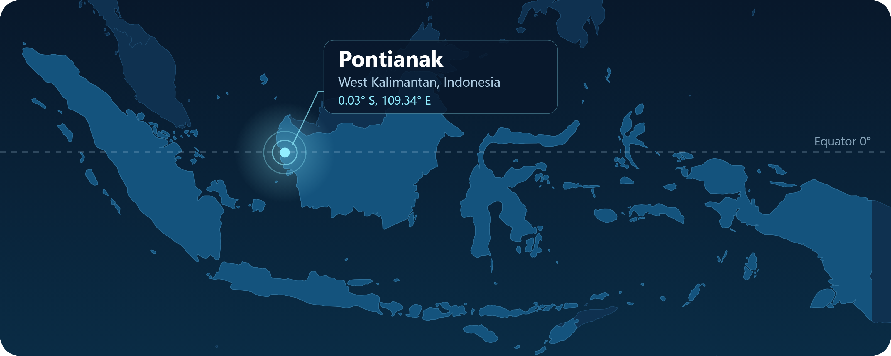

  

  <a href="https://muaraai.com"><b>Website</b></a>
  &nbsp;·&nbsp;
  <a href="https://mira.muaraai.com"><b>Mira</b></a>
  &nbsp;·&nbsp;
  <a href="https://ai.muaraai.com"><b>AI Portal</b></a>
  &nbsp;·&nbsp;
  <a href="https://github.com/MuaraAI/FluxCode/releases/latest"><b>FluxCode</b></a>
  &nbsp;·&nbsp;
  <a href="https://muaraai.com/onboarding"><b>Join</b></a>

  
  
  
  
  

MuaraAI is an independent team in Pontianak, Indonesia. We build software, local AI
systems, and open research. Our code is open source, and we write up our research so
anyone can repeat it.

## Projects

<table>
  <tr>
    <td width="50%" valign="top">
      <h3><a href="https://github.com/MuaraAI/Mira">Mira</a></h3>
      
One place for a university's student services. A PWA dashboard, REST API, and
      MCP server for academic records, e-learning, online exams, the library, news, and
      the research repository.

      

        
        
      

      
<a href="https://mira.muaraai.com">mira.muaraai.com</a> · MIT

    </td>
    <td width="50%" valign="top">
      <h3><a href="https://github.com/MuaraAI/FluxCode">FluxCode</a></h3>
      
A native code editor for Windows and Linux, written in Rust. It has an AI agent
      panel, a terminal that works well with Python, built-in source control, and no
      telemetry. Still in development.

      

        
        
      

      
Windows 10/11 and Linux x64 · GPL-3.0

    </td>
  </tr>
</table>

| Project | What it does | Stack |
| --- | --- | --- |
| [**MuaraAI&nbsp;Portal**](https://github.com/MuaraAI/MuaraAI) | Our website at [muaraai.com](https://muaraai.com), with the member directory, sign-up based on verified work, and a learning dashboard | TypeScript |
| [**AI&nbsp;Portal**](https://github.com/MuaraAI/ai-web) | API portal for the Muara V1 Flash model at [ai.muaraai.com](https://ai.muaraai.com). Sign in with your MuaraAI account and create your own API keys, which are generated and hashed in the browser | TypeScript |
| [**Laku**](https://github.com/MuaraAI/laku) | Restock forecasting for sellers on Shopee, TikTok Shop, and Tokopedia at [laku.muaraai.com](https://laku.muaraai.com). Built for the SIFEST 2026 hackathon | Python |
| [**Muara&nbsp;Skins**](https://github.com/MuaraAI/Skins) | Terminal skin pack and theme studio for Hermes Agent | Python |
| [**Harness&nbsp;DC**](https://github.com/MuaraAI/harness-dc) | Discord Rich Presence for AI coding agents (Hermes Agent and Antigravity) that runs without any setup | TypeScript |

## Based in Pontianak

  

We work out of Pontianak, West Kalimantan, a city that sits almost exactly on the equator.

## Team

<table>
  <tr>
    <td align="center" valign="top" width="200">
      <a href="https://github.com/Curzyori"> <b>Yuken Velino</b></a> 
      Founder · maintainer · builder
    </td>
    <td align="center" valign="top" width="200">
      <a href="https://github.com/Seeyaa77"> <b>Muhammad Raffli Aldiansyah</b></a> 
      Co-founder · maintainer · builder
    </td>
    <td align="center" valign="top" width="200">
      <a href="https://github.com/MyKineID"> <b>Verzio Yamanansyah</b></a> 
      Co-founder · maintainer · builder
    </td>
  </tr>
</table>

## Join us

We bring in new members based on what they have built. Send us a link to your work
(Proof of Work) at [muaraai.com/onboarding](https://muaraai.com/onboarding), connect your
GitHub account, and a maintainer will review it.

  

For partnerships, email [admin@muaraai.com](mailto:admin@muaraai.com).

---

  © 2026 MuaraAI · Built independently in Pontianak, Indonesia

